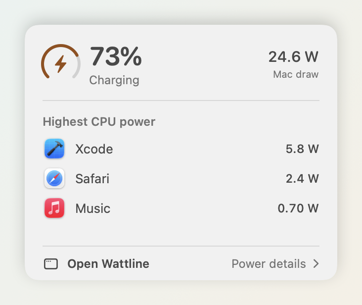
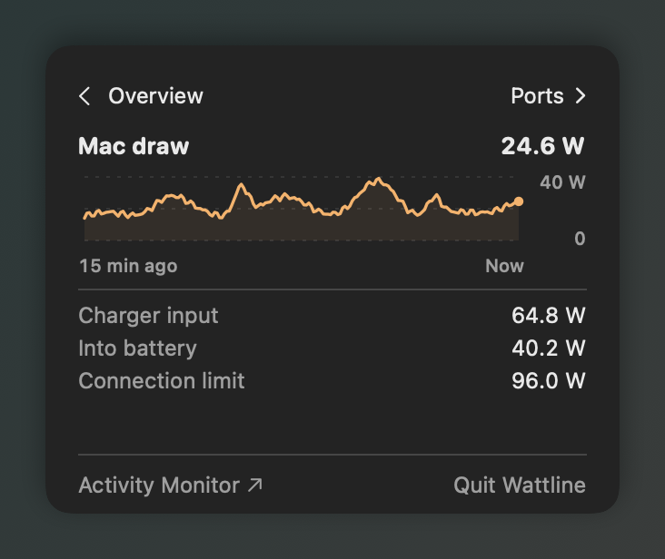
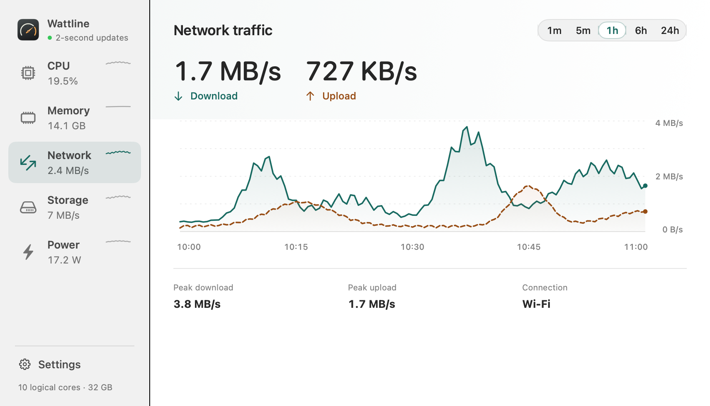
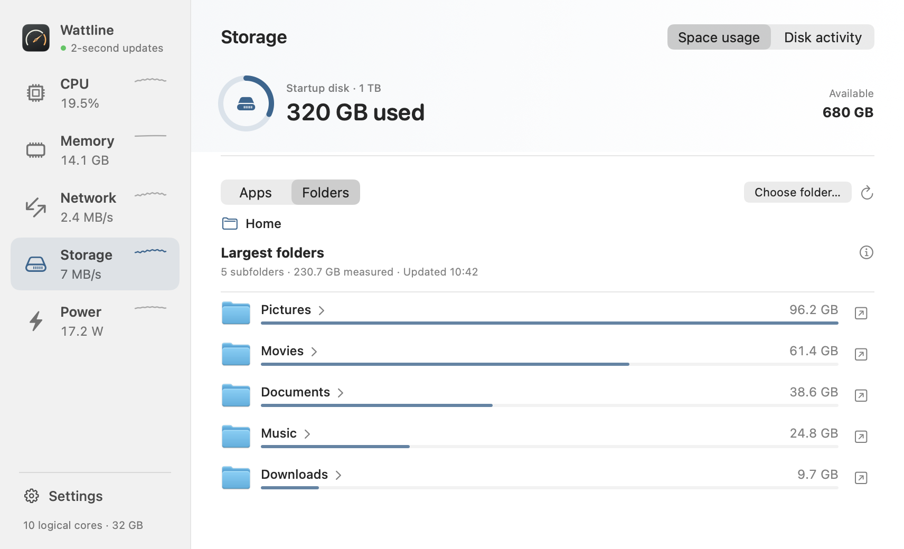

# Wattline

Wattline shows where your Mac’s power goes. Click its menu bar gauge to see current power draw and charging status. Open **Power details** to compare the power arriving from the charger with the power flowing into or out of the battery.

## Install

[Download Wattline 1.10.2 for macOS](https://github.com/Thorkee/Wattline/releases/download/v1.10.2/Wattline-1.10.2.dmg). The same disk image runs on Apple silicon and Intel Macs with macOS 14 or later.

Open the `.dmg`, drag **Wattline** onto **Applications**, then open Wattline from Applications. Its gauge appears in the menu bar.

Version 1.10.2 is ad-hoc signed and has no Apple notarization. If macOS blocks the first launch and you trust the download, try opening Wattline once, then choose **System Settings → Privacy & Security → Open Anyway**. [Apple’s first-launch guide](https://support.apple.com/en-us/102445)

## Screenshots

The compact menu shows current power and charging status. Expand **Power details** to see how much power the Mac is using and how much is reaching the battery. The screenshots use sample readings.

<p>
  
  
</p>

**Network history**



**Storage usage**



## Build from source

Wattline runs on macOS 14 or later on Apple silicon and Intel. To build from source, use a Mac with Xcode and its command-line tools selected. The package declares Swift tools version 5.10 and was tested with Xcode 26.5 (Swift 6.3.2). It uses Apple frameworks and has no third-party package dependencies.

Clone the project, build Wattline, and open the app.

```sh
git clone https://github.com/Thorkee/Wattline.git
cd Wattline
./build-app.sh
open .build/Wattline.app
```

The script builds both processor architectures and ad-hoc signs the universal app for local use. To keep it installed, quit Wattline, copy `.build/Wattline.app` into your Applications folder, and open that copy. Run `swift test` to execute the test suite.

## Using Wattline

- **Menu bar.** Click the gauge or press **Control–Option–Command–W** to open the compact power view. Choose **Open Wattline** for the dashboard. Under **Wattline → Settings**, enable **Show watts in menu bar** to put the current Mac draw beside the gauge.
- **Power and ports.** Compare charger input, Mac draw, and battery flow. **Power → Ports** shows the USB Power Delivery offer and selected connection limit when macOS reports them. These are ceilings. Live output watts appear for ports with a supported sensor, and missing measurements appear as unavailable. App rankings use estimated CPU power where available, with CPU usage as a fallback.
- **System history.** Explore CPU usage, memory pressure, network throughput, disk activity, and power draw. Charts cover up to 24 hours of locally recorded history. Settings lets you choose the chart range and a live refresh interval of 2, 5, or 10 seconds.
- **Space usage.** Rank installed apps or drill into a folder by allocated size on disk. Scans start manually by default, pause after a bounded amount of work, and can continue on request. Partial totals are marked in the results.
- **Health warnings.** Wattline looks for sustained battery drain on external power, high thermal or memory pressure, and a nearly full startup disk. The dropdown shows current warnings. Desktop notifications are opt-in under **Settings → Health**.

Wattline uses the native macOS menu bar in full screen. To keep it visible, search System Settings for **Automatically hide and show the menu bar** and choose **Never**. Choose **On Desktop Only** if you also want the bar to hide on the desktop. [Apple’s menu bar settings guide](https://support.apple.com/guide/mac-help/mchlad96d366/mac)

## Packaging a release

After building the app, run `./build-dmg.sh` with Python 3.11 or later available as `python3`. The script creates an isolated packaging environment, embeds the Finder artwork and a copy of the license, and verifies the resulting `.build/Wattline-<version>.dmg`. To package an existing signed bundle, set `WATTLINE_APP` to its path.

Set `WATTLINE_DEVELOPER_ID` to the exact name or SHA-1 fingerprint of a valid Developer ID Application signing identity before running `./build-app.sh`. This enables hardened runtime and secure timestamping. Apple notarization is a separate distribution step.

## License

Copyright © 2026 Thorkee. Wattline is licensed under the GNU General Public License, version 3 only (`GPL-3.0-only`). [Read the license](LICENSE).
